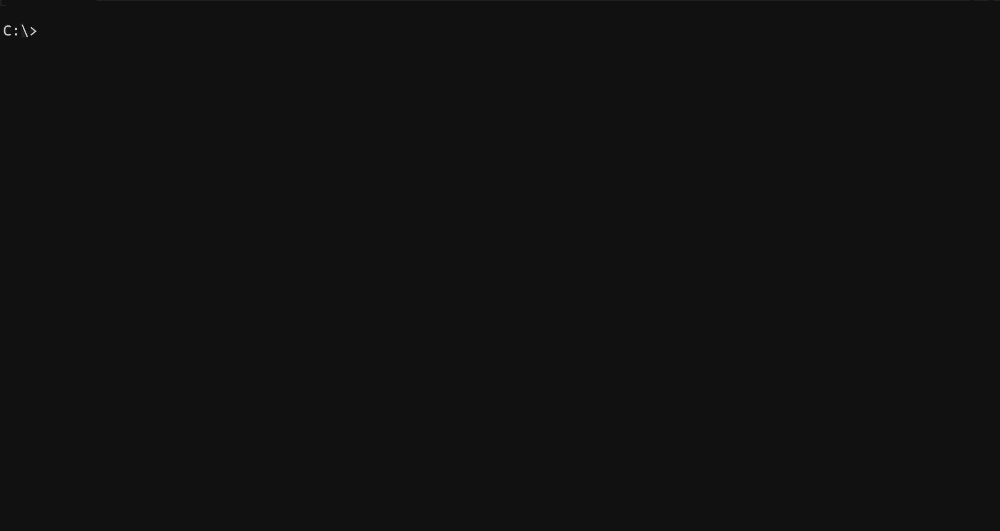

```
           ██████╗  ██████╗ ██╗    ██╗███████╗██████╗ ███████╗██╗  ██╗███████╗██╗     ██╗
           ██╔══██╗██╔═══██╗██║    ██║██╔════╝██╔══██╗██╔════╝██║  ██║██╔════╝██║     ██║
           ██████╔╝██║   ██║██║ █╗ ██║█████╗  ██████╔╝███████╗███████║█████╗  ██║     ██║
           ██╔═══╝ ██║   ██║██║███╗██║██╔══╝  ██╔══██╗╚════██║██╔══██║██╔══╝  ██║     ██║
           ██║     ╚██████╔╝╚███╔███╔╝███████╗██║  ██║███████║██║  ██║███████╗███████╗███████╗
           ╚═╝      ╚═════╝  ╚══╝╚══╝ ╚══════╝╚═╝  ╚═╝╚══════╝╚═╝  ╚═╝╚══════╝╚══════╝╚══════╝

 ██████ ██    ██ ███████ ████████  ██████  ███    ███ ██ ███████  █████  ████████ ██  ██████  ███    ██
██      ██    ██ ██         ██    ██    ██ ████  ████ ██    ███  ██   ██    ██    ██ ██    ██ ████   ██
██      ██    ██ ███████    ██    ██    ██ ██ ████ ██ ██   ███   ███████    ██    ██ ██    ██ ██ ██  ██
██      ██    ██      ██    ██    ██    ██ ██  ██  ██ ██  ███    ██   ██    ██    ██ ██    ██ ██  ██ ██
 ██████  ██████  ███████    ██     ██████  ██      ██ ██ ███████ ██   ██    ██    ██  ██████  ██   ████

========================================================================================================
```
By Pelle Schulte

# PowerShell Customization

Personal PowerShell and [Fastfetch](https://github.com/fastfetch-cli/fastfetch) configuration files by Pelle Schulte.



This repository contains a small set of opinionated customizations, designed
primarily for Windows. Everything within this repository also supports Linux but the installer applies less modifications. Review the files before
installing and adjust them to suit your own setup.

## What's included

- [`scripts/install.ps1`](./scripts/install.ps1) — installs the profile and Fastfetch alongside its configuration.
- [`src/Microsoft.PowerShell_profile.ps1`](./src/Microsoft.PowerShell_profile.ps1)
  — startup behavior, a colored prompt, and shell utilities.
- [`src/.config/fastfetch/config.jsonc`](./src/.config/fastfetch/config.jsonc)
  — the general Fastfetch configuration.
- [`src/.config/fastfetch/config.windows.jsonc`](./src/.config/fastfetch/config.windows.jsonc)
  — a Windows-oriented Fastfetch configuration with a custom logo.
- [`src/.config/fastfetch/logos/windows.txt`](./src/.config/fastfetch/logos/windows.txt)
  — the ASCII art used by the Windows configuration.

## Requirements
> [!IMPORTANT]
> Windows, by default, comes with PowerShell version 5 pre-installed, to install version 7 either get it directly from the [Microsoft Store](https://apps.microsoft.com/detail/9MZ1SNWT0N5D) or using `winget install Microsoft.PowerShell`.
- PowerShell 7 or later.
- Fastfetch. The installer offers to install it if it is not already available:
  it uses `winget` on Windows, or a supported Linux package manager.

## Option 1: Install with the script

From the repository root, run:

```powershell
.\scripts\install.ps1
```

The installer shows the destination files and asks for confirmation before
continuing. It installs the PowerShell profile to the current shell's `$PROFILE`
path and the general Fastfetch config to `~/.config/fastfetch/config.jsonc`.
On Windows, it also installs the logo to
`~/.config/fastfetch/logos/windows.txt` and updates the installed Fastfetch
config with the logo path and Windows colors. It creates destination folders
when needed.

If a destination already contains non-empty content, the installer asks before
overwriting it. It also asks whether to load the installed profile into the
current session when installation completes. You can restart PowerShell instead
to load the profile normally.

### Installer arguments

| Argument | Description |
| --- | --- |
| `-Y` | Runs without confirmation prompts. Existing files are overwritten, and the profile is not loaded automatically unless `-LoadNow` is also specified. |
| `-ProfilePath <path>` | Sets the profile destination. Defaults to `$PROFILE`. |
| `-FastfetchConfigPath <path>` | Sets the Fastfetch config destination. Defaults to `~/.config/fastfetch/config.jsonc`. |
| `-LogoPath <path>` | Sets the Windows logo destination. Defaults to `~/.config/fastfetch/logos/windows.txt`; used when installing for Windows. |
| `-Platform Windows\|Linux` | Overrides platform detection for selecting Windows-specific setup. |
| `-LoadNow` | Loads the newly installed profile in the current PowerShell session immediately. |

For each path argument, pass either the full destination file path or a directory
ending in a slash or backslash. When given a directory, the installer appends
the appropriate filename (`Microsoft.PowerShell_profile.ps1`,
`config.jsonc`, or `windows.txt`).

Examples:

```powershell
# Install with the default locations and answer the prompts
.\scripts\install.ps1

# Install without prompts, using custom destinations
.\scripts\install.ps1 -Y `
  -ProfilePath "$HOME\Documents\PowerShell\Microsoft.PowerShell_profile.ps1" `
  -FastfetchConfigPath "$HOME\.config\fastfetch\config.jsonc" `
  -LogoPath "$HOME\.config\fastfetch\logos\windows.txt"

# Install with prompts and load the profile into this session
.\scripts\install.ps1 -LoadNow

# Install without prompts and load the profile into this session
# Recommended for quick installs with immediate effect
.\scripts\install.ps1 -Y -LoadNow
```

`-Y` is useful for unattended installs: it accepts the install flow, overwrites
existing destination files, and suppresses the final load prompt. Add
`-LoadNow` if you also want the profile to be dot-sourced immediately.

## Option 2: Apply the files manually

Manual setup gives you control over which files you use and avoids running the
installer. Copy the files into the locations below; create the destination
directories first if they do not exist.

### PowerShell profile

Copy `src/Microsoft.PowerShell_profile.ps1` to the path reported by `$PROFILE`.
That path can vary by operating system, PowerShell edition, and host. To see the
exact path in your PowerShell session, run:

```powershell
$PROFILE
```

For example, a typical PowerShell 7 location on Windows is
`Documents\PowerShell\Microsoft.PowerShell_profile.ps1`; on Linux it is
`~/.config/powershell/Microsoft.PowerShell_profile.ps1`. Restart PowerShell
after copying the file, or load it into the current session with:

```powershell
. $PROFILE
```

### Fastfetch configuration

Fastfetch looks for its default user configuration at
`~/.config/fastfetch/config.jsonc`. Copy **one** of these repository files there
and name the copy `config.jsonc`:

- `src/.config/fastfetch/config.jsonc` for the general configuration.
- `src/.config/fastfetch/config.windows.jsonc` for its Windows-specific colors
  and custom logo.

If you use `config.windows.jsonc`, also copy
`src/.config/fastfetch/logos/windows.txt` to
`~/.config/fastfetch/logos/windows.txt`. The config refers to the logo at that
exact path. On Windows, `~` means your user home directory.

The installer always copies the general `config.jsonc`; on Windows it adds the
logo settings to that installed config automatically. To use the separate
`config.windows.jsonc` file with the installer, install first and then replace
the installed config with your chosen file, or follow the manual steps above.

## What the profile does

When PowerShell starts, the profile:

- Runs `fastfetch`, showing system information and the operating System Logo.
- Defines a colored prompt showing the current time, user and computer name,
  current directory, and an elevated-session marker (`ADMIN` on Windows or
  `SUDO` on Unix-like systems).
- Defines `$Styles`, a collection of ANSI escape sequences for text attributes
  and foreground and background colors.
- On Windows, defines utilities for working with security identifiers and
  named pipes:
  - `ConvertTo-IdentityName` translates a SID to an account name, falling back
    to its original value if translation fails.
  - `Get-NamedPipes` lists named pipes on a machine, with optional name filter
    and machine name.
  - `Get-PipeSecurity` connects to a named pipe and returns its owner and access
    rules, with an optional connection timeout.

The prompt and utilities are personal preferences, not a requirement for
PowerShell or Fastfetch. **Edit the copied profile and Fastfetch config to make
them your own**.

## Further terminal options on Windows

My personal preference for the Windows Terminal App is to use the **Dark+** color scheme & the "**Consolas**" font.

---
Licensed under the **MIT License**, you may obtain a copy of the License in the included [License.txt](./LICENSE.txt) file.